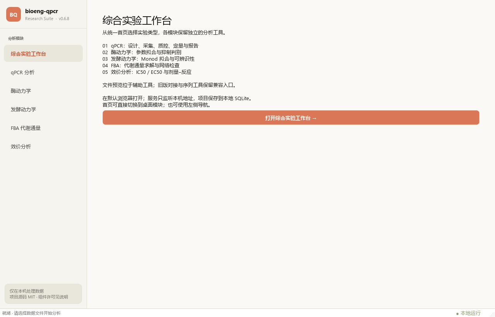

# bioeng-qpcr · qPCR 定量分析工作台

把 **CSV / RDML → 质控 → 相对或绝对定量 → 图表与报告** 放进同一个本地工作台，保留输入、参数、警告和分析历史，方便科研与教学中的结果复核。

*Local qPCR analysis with traceable inputs, quality checks and reports.*

**[下载 Windows 0.6.8](https://github.com/tomaxiwu-bit/bioeng-qpcr/releases/tag/v0.6.8)** · [五分钟试用](docs/QUICKSTART_ZH.md) · [公开数据验证](docs/PUBLIC_DATA_VALIDATION.md) · [详细使用手册](docs/RESEARCHER_GUIDE.md)



## 先看一次能完成什么

打开内置的“脑 / 肾基因表达对比”示例，从实验设计、公开数据回放、Ct 计算和质控走到定量，可查看 kidney / brain 的 **5.6373 倍**表达变化，并下载定量 CSV、项目备份和 HTML 报告。

这个数值来自固定公开示例。示例中缺少原始曲线、对照和效率验证的部分会保留为证据缺口；方法假设需要使用者确认。可以先查看 [报告示例](docs/demo/qpcr-report.html)（下载后用浏览器打开）和 [验证依据](docs/PUBLIC_DATA_VALIDATION.md)，再决定是否导入自己的数据。

| 你的任务 | 工作台提供什么 | 可带走的结果 |
|---|---|---|
| 整理一次 qPCR 实验 | 样品、引物 / 探针、96/384 孔板位与运行快照 | 项目 JSON 与实验记录 |
| 检查输入和实验质量 | CSV / RDML 校验、技术重复检查、参考基因评估与 readiness 报告 | 带位置的诊断、警告与证据缺口 |
| 计算表达变化 | 效率校正、ΔΔCt、标准曲线等定量路径 | 定量 CSV、图表与 HTML 报告 |
| 复核分析选择 | 输入、方法、参数、软件版本与分析历史 | 可恢复的项目和可追溯结果 |

## 五分钟试用

1. 在 [v0.6.8 Releases](https://github.com/tomaxiwu-bit/bioeng-qpcr/releases/tag/v0.6.8) 下载 `bioeng-qpcr-0.6.8-win64-portable.zip`，**完整解压**后打开 `bioeng-qpcr.exe`。便携版无需安装 Python。
2. 点击“打开综合实验工作台”，进入 qPCR，选择“脑 / 肾基因表达对比”。
3. 按页面步骤检查设计、回放数据、计算 Ct 与质控，确认示例方法假设后执行定量。
4. 检查样本点、警告和表达变化，导出 CSV、项目备份与报告。

准备导入自己的实验时，先看 [CSV 导入规范](docs/CSV_IMPORT_SPEC.md)。软件目前通过文件采集仪器数据，尚未接入厂商 SDK 控制硬件。

## 从源码启动

需要 Python 3.10+。以下是使用 Python 3.12 的 PowerShell 示例：

```powershell
git clone https://github.com/tomaxiwu-bit/bioeng-qpcr.git
Set-Location bioeng-qpcr
py -3.12 -m venv .venv
.venv\Scripts\python.exe -m pip install ".[web,fba]"
.venv\Scripts\python.exe -m bioeng_qpcr.web
```

打开 <http://127.0.0.1:8008/lab>。关闭终端中的服务即可停止。安装、依赖与打包问题见 [快速开始](docs/QUICKSTART_ZH.md) 和 [复现与构建](docs/REPRODUCIBILITY.md)。

## qPCR 之外的工具

综合首页还提供酶动力学、发酵动力学、FBA 代谢通量和效价分析。浏览器端工具可归档、恢复和导出；`/history` 管理这些记录，qPCR 项目历史在 `/workbench` 中管理。

原桌面页保留独立计算入口。简化分子对接、序列比对、文件与图片预览属于辅助或兼容工具，其具体方法和适用范围见 [CLI 与开发参考](docs/REFERENCE.md)。

## 按需要继续阅读

| 想了解什么 | 入口 |
|---|---|
| 如何完成首次实验分析 | [中文快速开始](docs/QUICKSTART_ZH.md) |
| 怎样组织真实实验与复核结果 | [研究者使用手册](docs/RESEARCHER_GUIDE.md) |
| 导入文件需要哪些列 | [CSV 导入规范](docs/CSV_IMPORT_SPEC.md) |
| 公开数据如何验证实现 | [公开数据验证](docs/PUBLIC_DATA_VALIDATION.md) |
| CLI、算法、辅助工具与限制 | [详细参考](docs/REFERENCE.md) |
| 如何重建软件与便携包 | [复现与构建](docs/REPRODUCIBILITY.md) |
| 本版修改了什么 | [0.6.8 版本记录](docs/RELEASE_NOTES_v0.6.8.md) |

## 使用范围与开发

当前为 **0.6.8 研究与教学试用版**。MIQE readiness 报告用于展示可评估项和缺失证据，不是完整 MIQE 合规认证。计算结果需要结合实验室 SOP 与实验设计复核；公开案例与软件测试也不能替代独立实验室验证。

源码按数据导入、计算、校验、统计、绘图和溯源分层，界面与 CLI 共享计算逻辑。需要执行开发检查时，在项目根目录使用上面建立的虚拟环境：

```powershell
.venv\Scripts\python.exe -m pip install -e ".[dev]"
.venv\Scripts\python.exe -m pytest
.venv\Scripts\python.exe -m ruff check .
.venv\Scripts\python.exe scripts/validate_public_data.py
```

反馈与贡献见 [CONTRIBUTING.md](CONTRIBUTING.md)，问题可提交到 [Issues](https://github.com/tomaxiwu-bit/bioeng-qpcr/issues)。代码采用 [MIT](LICENSE)；第三方组件和数据说明见 [THIRD_PARTY_NOTICES.md](THIRD_PARTY_NOTICES.md)，引用信息见 [CITATION.cff](CITATION.cff)。
